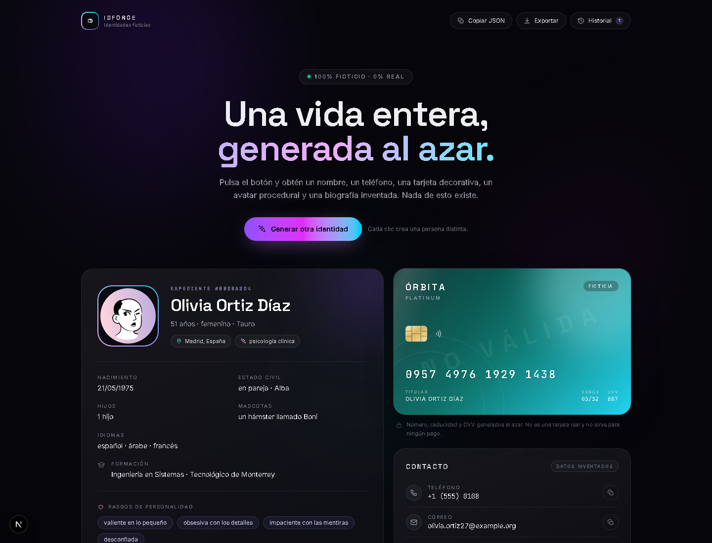

# IDForge

**Forge fictional identities in seconds.**

IDForge is a generative fictional identity generator designed to create detailed, realistic-looking fictional personas in seconds. From personal information to complete life stories, IDForge brings fictional characters to life through automatically generated profiles. The interface is in Spanish.



<p>
  
  
  
  
</p>

## Features

- **Generative Identity Creation** — Generate complete fictional identities procedurally from curated data pools.
- **Personal Information** — Name, age, gender, city, occupation, education, family, languages, pets, and personality traits.
- **Phone Numbers** — Fictional numbers inside the reserved `555-0100` to `555-0199` range.
- **Financial Data** — Simulated card brand, number, expiry, and CVV for fictional profiles. Card numbers are random and intentionally invalid.
- **Personal Stories** — Four generated paragraphs plus a timeline that connects childhood, a turning point, and the present.
- **Education History** — Schools, degrees, and academic backgrounds that fit the fictional profile.
- **Professional Profiles** — Jobs, career paths, and workplace details generated for each persona.
- **Detailed Profiles** — Hobbies, fears, quirks, secrets, and personality traits that make each character feel lived-in.
- **Procedural Avatars** — Unique SVG portraits generated locally with DiceBear. No photos of real people.
- **Local History and Export** — Keep the last eight identities in `localStorage`, copy individual fields, or export the whole profile as JSON.
- **Modern Responsive UI** — Dark glassmorphism, gradient lighting, micro-animations, and a layout that works on mobile.
- **No Backend, No Database** — Everything is generated and stored in the browser.

## Important Notice

IDForge is a tool for creative writing, role-playing games, prototypes, and UI testing. It generates fictional data only. Card numbers are random and fail the Luhn check, phone numbers use a reserved range, and no real financial accounts or identities are created. Do not use generated content to impersonate anyone, commit fraud, or deceive third parties.

## Requirements

- Git
- Node.js 20 or later
- npm 10 or later
- Python 3.8 or later (optional, for `open.py`)

No extra dependencies are required. IDForge runs locally and has no backend.

## Installation

Clone the repository:

```bash
git clone https://github.com/RekiCv/IDForge.git
cd IDForge
```

Then launch it:

```bash
python open.py
```

`open.py` checks Node.js, installs dependencies with `npm install` if `node_modules` is missing, starts the development server, and opens [http://localhost:3000](http://localhost:3000) in your browser. If `python` is not on your PATH on Windows, use `py open.py`.

### Manual start

```bash
npm install
npm run dev
```

Open [http://localhost:3000](http://localhost:3000) in your browser.

### Production build

```bash
npm run build
npm run start
```

There is no pre-built release yet. The project runs locally with the commands above.

### Launcher options

```bash
python open.py --port 3100
python open.py --no-browser
python open.py --prod
```

## How to Use

1. Run `python open.py` (or `npm run dev`).
2. Click **Generar identidad** to create a new fictional person.
3. Review the profile, avatar, contact data, decorative card, biography, and facts.
4. Copy individual fields, copy the whole identity as JSON, or download it.
5. Open the history drawer to restore one of the last eight identities.
6. Generate again whenever you want someone new.

Everything stays in your browser. No data is sent to a server.

## Project Structure

```text
IDForge/
├── app/
│   ├── layout.tsx          Fonts, metadata and global shell
│   ├── page.tsx            Renders the identity app
│   └── globals.css         Tailwind theme, effects and animations
├── components/
│   ├── IdentityApp.tsx     State, generation flow, export and history
│   ├── Hero.tsx            Landing section and generate button
│   ├── PersonaPanel.tsx    Avatar and personal data
│   ├── FakeCard.tsx        Decorative fictional bank card
│   ├── ContactPanel.tsx    Phone, email and address with copy buttons
│   ├── LorePanel.tsx       Biography and timeline
│   ├── FactsPanel.tsx      Hobbies, fears, quirks and secrets
│   ├── HistoryDrawer.tsx   Slide-over with previous identities
│   ├── Toolbar.tsx         Copy, export and history actions
│   ├── Toast.tsx           Feedback messages
│   ├── Disclaimer.tsx      Fictional-content notice
│   ├── BackgroundFX.tsx    Gradient and grain background
│   └── icons.tsx           Inline SVG icon set
├── lib/
│   ├── data.ts             Spanish name, city, job and lore pools
│   ├── generator.ts        Random generator and avatar creation
│   └── types.ts            Identity and lore types
├── docs/
│   └── preview.png         README preview image
├── .github/
│   └── workflows/
│       └── ci.yml          Lint and build checks
├── open.py                 Launcher that starts the app and opens the browser
├── package.json
└── README.md
```

## Tech Stack

- **Next.js 16** (App Router)
- **React 19**
- **TypeScript**
- **Tailwind CSS v4**
- **DiceBear** for procedural avatars
- **localStorage** for history

The generator lives in `lib/generator.ts`. It picks values from curated Spanish-language pools in `lib/data.ts`, builds the biography from templates, and creates the avatar locally. Card numbers are deliberately forced to fail the Luhn check, and phone numbers stay inside the reserved `555-01XX` range.

## Project Status

IDForge is an experimental project built primarily with AI assistance (vibecoding) to explore generative interfaces and playful identity design. Identity generation runs locally and procedurally: the app does not call an AI model or an external API at runtime. Features and data pools may change over time.

## Disclaimer

Everything generated by this app is **fictional**. Names, addresses, emails, phone numbers, bank cards, and biographies do not belong to real people. Card numbers are random and invalid, and phone numbers use a reserved range.

This project is meant for creative writing, role-playing games, prototypes, and UI testing. Do not use it to impersonate anyone, commit fraud, or deceive third parties.

---

# ☕ Enjoying IDForge?

If you like the project and want to support its development, consider leaving a donation! Every bit of support is appreciated and helps motivate future improvements.

<p align="center">
  <a href="https://donatr.ee/senkiu?utm_source=copy&amp;utm_medium=share">
    
  </a>
</p>

<p align="center">
  <sub>Built with curiosity, AI, and a little vibecoding.</sub>
</p>
